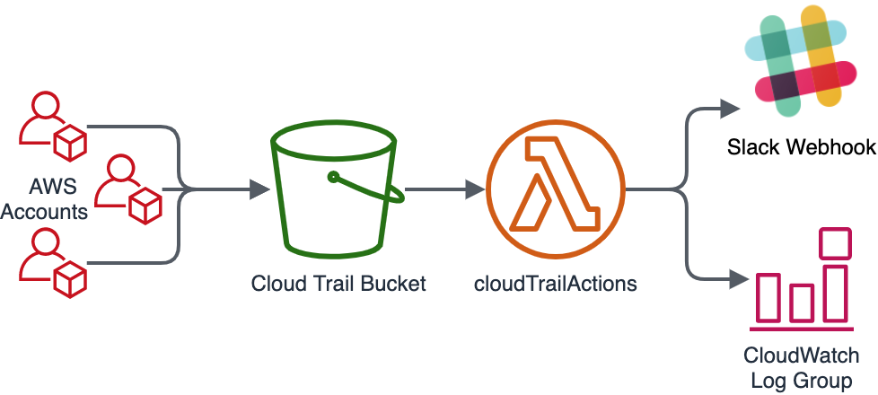

# CloudTrail Console Actions

> **Upgrading from v0.x?** v2 is a drop-in replacement. Deploy the new artifact with the same Terraform module; no filter, policy or Slack configuration changes are needed. See the [CHANGELOG](./CHANGELOG.md) for the details.

_**Problem:**_ CloudTrail's signal-to-noise ratio is too noisy for a human to follow. This Lambda finds actionable (console-originated) events and alerts them to CloudWatch Logs and, optionally, Slack.

Filtering is driven by a declarative policy: the rules live in a YAML document ([schema](./policy.schema.json)), a default ruleset is baked into the binary, and you can override it without recompiling.

## How it works

Every CloudTrail log file delivered to S3 (directly, or via SNS/SQS notification) is streamed through the policy engine. For each record:

1. **preprocess**: working values are computed (e.g. the normalized event name, the human `userName`) and exposed to rules as `preprocess.*`.
2. **decide**: the record is **emitted unless** a `skip` rule applies (`match` and not `exclude`) **and** no `keep` rule matches. `keep` beats `skip`; skip rules combine as a union.
3. **outputs**: emitted records are projected to the log/Slack schema defined in the policy's `outputs:` section.

Emitted records are grouped (deduplicated) by `(account, eventSource, userName, eventName, errorCode)` and flushed as one notification with a count and time window. Deduplication can be disabled (see below).



## Installation

Every tagged release on [GitHub Releases](https://github.com/Techcadia/cloudtrail-console-actions/releases) has prebuilt `function_arm64.zip` and `function_amd64.zip` artifacts with a `sha256sums.txt`.

To build from source you need Go 1.27+. The Makefile builds a `provided.al2023`-compatible `bootstrap` binary (default `ARCH=arm64`; use `make zip ARCH=amd64` for x86_64):

```shell
git clone git@github.com:Techcadia/cloudtrail-console-actions.git
cd cloudtrail-console-actions
make zip
```

This outputs `dist/function_arm64.zip` plus a `sha256sums.txt`. Point the Terraform [S3 example](./terraform/example-com_s3) or [SNS example](./terraform/example-com_sns) at it.

## Configuration

Flags beat environment variables beat defaults:

| Flag | Env | Default | Purpose |
| --- | --- | --- | --- |
| `--config-file` | `CCA_POLICY_FILE` | embedded policy | Path to a FilterPolicy YAML overriding the embedded default ruleset |
| `--dedupe` | `CCA_DEDUPE` | `true` | Group identical `(account, source, user, event, error)` records into one `Nx` notification; `false` alerts per record |
| `--log-level` | `LOG_LEVEL` | `info` | `debug` explains every rule decision per record |
| `--validate-only` | | | Parse + compile the policy, report, exit |
| `--dump-default-policy` | | | Print the embedded policy to stdout (a starting point for overrides) |

Slack delivery:

* `SLACK_WEBHOOK`: (Optional) webhook URL; unset means logs only.
* `SLACK_CHANNEL`: (Optional) channel to post to.
* `SLACK_NAME`: (Optional) default display name for the account.
* `SLACK_NAME_${AWS_ACCOUNT_NUMBER}`: (Optional) per-account display name, keyed on the recipient account (`account_id` output). Emojis like `:maple_leaf:` work.

## Writing a policy

Start from the embedded ruleset. From a checkout (the released `bootstrap` is a Linux binary, so run it from source on other platforms):

```shell
go run ./cmd/lambda --dump-default-policy > policy.yaml
# edit...
go run ./cmd/lambda --config-file policy.yaml --validate-only
```

Deploy it by passing the YAML to the Terraform module, which ships it to the Lambda as a layer and points `CCA_POLICY_FILE` at it:

```hcl
module "default" {
  source = "../modules/cloudtrailconsole/s3"
  # ...
  policy = file("${path.module}/policy.yaml")
}
```

Leave `policy` unset to use the embedded default.

A policy has four sections (see [policy.schema.json](./policy.schema.json) and the inline documentation in the [default policy](./internal/policy/default.yaml)):

```yaml
apiVersion: cca/v1
kind: FilterPolicy

preprocess:            # working values, addressed as preprocess.*
  eventName:
    - when:
        all:
          - { key: "{{ eventSource }}", operator: Equals, value: billingconsole.amazonaws.com }
      value: "{{ trimPrefix(eventName, 'AWSPaymentPortalService.') }}"
    - value: "{{ eventName }}"

keep:                  # global vetoes: an applicable keep forces EMIT
  - name: always-surface-security-writes
    match:
      any:
        - { key: "{{ preprocess.eventName }}", operator: AnyIn, value: [DeleteTrail, StopLogging] }

filters:               # skip rules: any applicable rule drops the record
  - name: drop-non-console-user-agent
    action: skip
    match:
      all:
        - { key: "{{ userAgent || '' }}", operator: NotEquals, value: "" }
    exclude:           # carve-out: matched records that also match this stay
      any:
        - { key: "{{ userAgent }}", operator: AnyIn, value: ["Mozilla/*", console.amazonaws.com] }

outputs:               # projection of emitted records to the log/Slack schema
  event_name: "{{ eventName }}"
  user_name:  "{{ preprocess.userName }}"
```

**Expressions** are `{{ ... }}` templates: dotted paths into the record (`"quoted"` names for fields like `requestParameters."x-amz-acl"`), `[n]` indexing, `|| ''` fallback for optional fields, and the functions `trimPrefix(s, prefix)`, `contains(s, substr)`, `split(s, sep)` and `keys(obj)`. This is a small custom language, **not JMESPath**. An unresolvable path evaluates to `null` (falsy) rather than erroring, so a typo reads as an always-false rule. See [docs/policy-language.md](./docs/policy-language.md) for the full grammar and falsy semantics.

**Operators:**

* `Equals` / `NotEquals`: exact, no wildcards
* `AnyIn` / `AllIn` / `AnyNotIn` / `AllNotIn`: set membership; values may use `*` and `?` (`Foo*` prefix, `*Foo` suffix, `*Foo*` contains)
* `GreaterThan(OrEquals)` / `LessThan(OrEquals)`: numeric
* `Matches` / `NotMatches`: RE2 regex list, any-of

Quote account IDs and other zero-padded values (`"012345670123"`); the loader rejects unquoted ones because YAML would read them as numbers.

**Outputs contract:** every `outputs:` field lands on the `Event` log line. The Slack notifier reads `event_source`, `user_name`, `account_id`, `error_code`, `event_id` and `aws_region`; override them to change what notifications show. Its headline event name is `preprocess.eventName` (the grouping key), not the `event_name` output.

## Observability

CloudWatch search terms:

```
fields @timestamp, @message
| sort @timestamp desc
| filter msg == "Event"
```

Example `Event` line:

```json
{
  "time": "2026-07-07T19:18:19Z",
  "level": "INFO",
  "msg": "Event",
  "account_id": "123456789012",
  "aws_region": "us-east-1",
  "count": 1,
  "event_id": "ec20d295-2332-4871-9a0c-0f3193119eb6",
  "event_name": "PutUserPolicy",
  "event_source": "iam.amazonaws.com",
  "event_time": "2026-07-07T19:03:40Z",
  "principal": "AIDA123456789EXAMPLE:john.doe@example.com",
  "user_agent": "Mozilla/5.0 ...",
  "user_name": "john.doe@example.com",
  "s3_uri": "s3://my-trail-bucket/AWSLogs/.../x.json.gz"
}
```

With `LOG_LEVEL=debug`, every record additionally logs its decision with a full rule trace: which rule dropped it, why each other rule did not match (down to the first failing condition and the value it saw), and any keep veto:

```json
{
  "level": "DEBUG",
  "msg": "record dropped",
  "event_name": "GetObject",
  "dropped_by": "drop-read-prefixes-title",
  "trace": [
    "skip rule \"drop-aws-internal-invoked\" did not match: condition [{{ userIdentity.invokedBy || '' }} Equals AWS Internal] not satisfied (got \"\")",
    "skip rule \"drop-read-prefixes-title\" matched: [{{ preprocess.eventName }} Matches [^[Gg]et ^[Ll]ist ^[Vv]iew]] (got \"GetObject\")",
    "decision: DROP by rule \"drop-read-prefixes-title\""
  ]
}
```

## Default policy

The embedded [default policy](./internal/policy/default.yaml) keeps console and sign-in activity and drops read-only calls, service-to-service traffic and known noise. Its `keep` rule always surfaces writes that disable logging or detection (`DeleteTrail`, `StopLogging`, `UpdateTrail`, `DeleteFlowLogs`, GuardDuty `DeleteDetector`, `DisableSecurityHub`, AWS Config recorder and delivery-channel shutdowns) and `PutUserPolicy`, whatever tool made the call, unless AWS made it on your behalf (`invokedBy: AWS Internal`). CloudTrail digest, Config and Insights files are ignored.

A golden test runs ~715k records through the policy and a reference implementation of the v0.4.0 rules and requires identical decisions.

## Cost

This Lambda streams and filters in microseconds per record; the dominant cost is invocation volume. In an organization with 15 accounts and ~100 console users we see ~100 executions/minute at ~200ms average, roughly $8/month in `us-west-2`. Size memory at 256 to 512 MB to avoid timeouts (see below).

## Tips and Troubleshooting

### Processing Events

Depending on the size of your AWS organization you may receive a LOT of CloudTrail files. The examples in this repository set `reserved_concurrent_executions = 10`; check the Lambda's Throttling metrics and raise it if needed.


### Timeouts

The Terraform module defaults the Lambda timeout to 15 seconds and memory to 256 MB. If executions hit the timeout, raise memory to 512, since CPU scales with memory.


## License

[MIT](./LICENSE)
